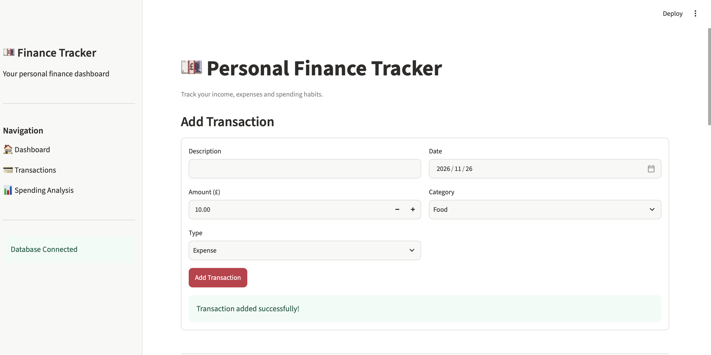
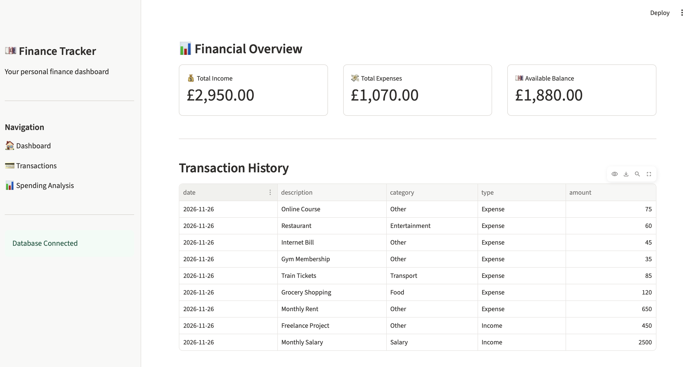
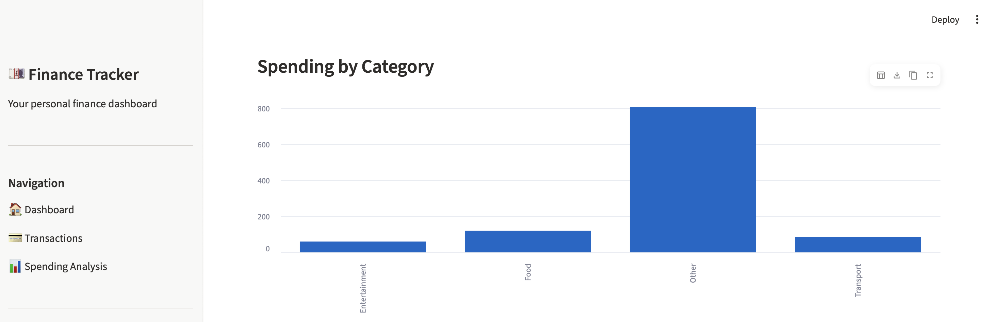
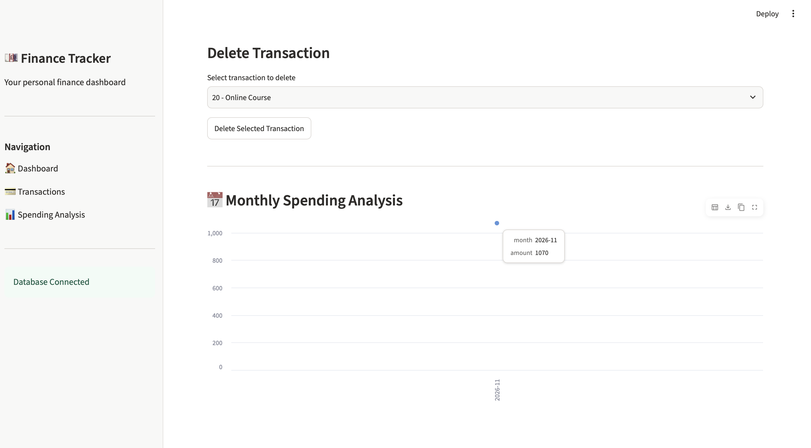

# Personal Finance Tracker

## Overview

A Python-based personal finance management application designed to help users track income, monitor expenses and manage their finances through an interactive dashboard.

## Features

- Record income and expenses
- Categorise financial transactions
- View total income, expenses and available balance
- View transaction history
- Visualise spending by category
- Analyse monthly spending trends
- Delete transactions
- Persistent local database storage

## Technologies Used

- Python
- Streamlit
- Pandas
- SQLite

## Installation

1. Clone this repository.
2. Create a Python virtual environment.
3. Install the required dependencies:

   pip install -r requirements.txt

4. Launch the application:

   streamlit run app.py

## Skills Demonstrated

- Python programming
- SQL database management
- Data analysis and visualisation
- Interactive dashboard development
- CRUD operations
- Financial data processing

## Project Status

Working prototype using a local SQLite database.
Personal financial records are excluded from this repository.

## Author

Samuel Sodipo
Computer Science Student
Northumbria University

## Application Screenshots

### Add Transaction

### Financial Dashboard

### Spending by Category

### Monthly Spending Analysis

